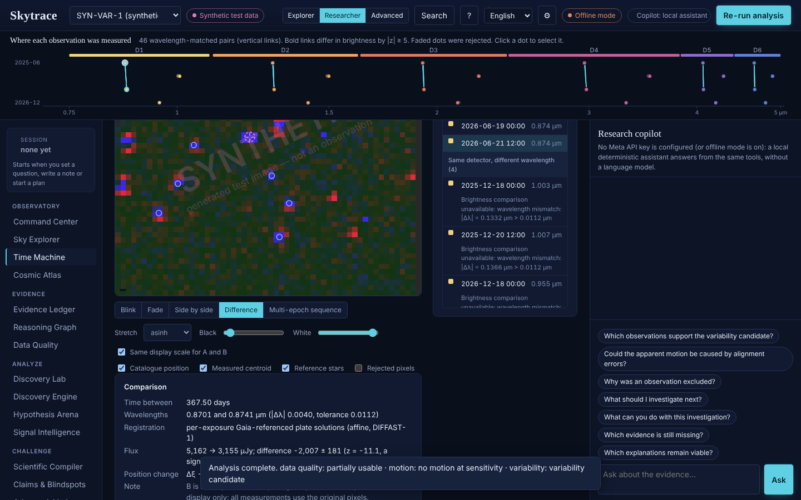

# Skytrace

Skytrace investigates NASA SPHEREx's repeated near-infrared images of the same piece of sky. Pick a target and it finds every SPHEREx image covering it. It measures the target in each image and compares epochs only where the comparison is physically meaningful. It then reports what changed, how it was measured and how certain it is. Every claim traces back to the archive file it came from. A research copilot (Meta Model API) explains the evidence through read-only tools, and an evidence guard blocks any answer the data do not support.

**The model explains. The algorithms measure. The data provide evidence. The user investigates.**



## Preview

| Way to open it | Command / link | What runs |
|---|---|---|
| **Hosted preview** (claude.ai artifact, private to its owner until shared) | https://claude.ai/artifact/RoUxXMSEELpbxBHj8wgzpT | the static build below: the same interface, with every result precomputed by the Python pipeline from the synthetic targets |
| Static preview, locally | `python scripts/build_static.py && python -m http.server -d dist/preview 8700` → http://127.0.0.1:8700/ | the same files, no backend |
| **Full application** | `OFFLINE=1 python run.py` → http://127.0.0.1:8600 | the server: live analysis with any parameters, the copilot loop, server-side records and replay |

The static preview says on every screen that it is a preview of precomputed results. Things that need the server
(arbitrary parameters, questions about named observations, replay by re-execution) are disabled or refused with
an explanation; pair comparisons, image registration and record-hash checks run in the browser with code that is
tested for parity with the Python implementation.

## Status (v0.10.0, 2026-11-03)

Phase 10 made Skytrace multilingual and added a signal workbench, a world model and an open science gateway. It includes:

- six interface languages — English, বাংলা, हिन्दी, Español, Français, Deutsch — chosen in the navigation or Settings and
  remembered; every interface message translated (tested), a 48-term scientific terminology base, and reports in all six
  languages with every number unchanged. **The translations were made by an AI model and have not been reviewed by native
  speakers**; the interface and every translated report say so ([docs/I18N.md](docs/I18N.md))
- cross-language search by exact text, terminology mapping and lexical matching — labelled as such: it is **not** semantic search
- a translation quality observatory (counts per language, terminology consistency, clipped-text check)
- Signal Intelligence: ten time-series methods, each shown as applicable or not with its reason; BIC only when its assumptions hold
- a World Model with discovery convergence (repeated use of the same data is never confirmation), research leads from
  contradictions, a multimodal table and a timeline that keeps four kinds of time apart
- negative space in nine distinctions, compiler statuses, a director that asks before each step, role agents with a debate
  record (not independent confirmation), an experiment marketplace, explanations in eight layers
- an Open Science Gateway: a validated handoff protocol, a flight recorder (tamper-evident, not cryptographic), a
  reproducibility bundle and reports in any language — nothing is uploaded

External sources (IRSA releases, Gaia alerts, TNS, ATel, arXiv, ADS) are listed as **not connected**. The data are still
synthetic. See [docs/PHASE10_AUDIT.md](docs/PHASE10_AUDIT.md), [docs/UNIVERSAL_METHODS.md](docs/UNIVERSAL_METHODS.md) and the
[Phase 10 catalogue](docs/PHASE10_CATALOGUE.md) (800 ideas, a roadmap).

Phase 9 added a scientific intelligence layer: one *Scientific Intelligence* workspace with twelve panels in six layers
(observation, discovery, reasoning, experimental, knowledge, integrity) over a shared entity model. It includes:

- research memory across investigations that never turns a hypothesis into a fact, with concept recall and memory of failure
- discovery genomes (thirteen cited fields, structural comparison, no score) with a sensitivity fingerprint and an uncertainty
  budget
- an unknown-universe map of eight rule-defined regions and a multi-discovery network whose every edge states its rule, basis and
  limitation
- a scientific adversary whose every challenge names its rule, an instrumental reality check, and a causality lab that never
  infers causation from correlation
- a what-if lab that answers only where a method exists, and an observation oracle of hypothetical plans under a validated model
- a research cycle with advisory, supervised and restricted-automation levels and an audit log
- reproduction manifests with comparison classes, and an integrity gate with research debt, time capsules, handoffs and a
  knowledge export

Every panel labels what it shows as real, synthetic, simulated, hypothetical, unverified or verified. The data are still
synthetic. See [docs/PHASE9_AUDIT.md](docs/PHASE9_AUDIT.md), [docs/INTELLIGENCE_METHODS.md](docs/INTELLIGENCE_METHODS.md) and the
[Phase 9 catalogue](docs/PHASE9_CATALOGUE.md) (600 concepts, a roadmap).

Phase 8 added an epistemic layer: Skytrace now shows how each conclusion is built and tests it. It includes:

- a reasoning graph of fifteen kinds of scientific object, with statuses grounded in source and method, and backward and
  forward tracing to files, methods and assumptions
- a scientific compiler (ten stages; passing is never called proof) and a method genome
- a scientific debugger with recomputation, differential debugging and graded independent reproduction
- a knowledge boundary without confidence numbers, ten-mode claim stress tests and blindspots over defined checks
- a negative-knowledge registry, an uncertainty flow that lists what is not propagated, and data lineage
- a model arena, a validated FutureLab, decision records and a question forge
- an integrity firewall that never blocks or rewrites
- protocols with locks and amendments, blind analysis, a Reasoning Lab, a hash-chained evidence vault and a review board

See [docs/PHASE8_AUDIT.md](docs/PHASE8_AUDIT.md), [docs/EPISTEMIC_METHODS.md](docs/EPISTEMIC_METHODS.md) and the
[Phase 8 catalogue](docs/PHASE8_CATALOGUE.md). Which capabilities are interactive, precomputed or server-only in the preview:
[docs/PREVIEW.md](docs/PREVIEW.md).

Phase 7 added a frontier laboratory on top of the research system. It includes:

- counterfactual scenarios that never touch the original run
- a Synthetic Observatory with ground truth, reproducible to the byte, and a hypothetical Observation Design Lab
- an Adversarial Science Lab whose challenges come only from documented rules, with test ranking and a causality workbench
- a Discovery Horizon of research opportunities
- a Review Room with a reproducibility challenge and an evidence-bound story
- a permission-levelled autopilot
- a Cosmic Atlas that stays angular
- exact knowledge search and astro-twins (hashed computational records)

See [docs/PHASE7_AUDIT.md](docs/PHASE7_AUDIT.md), [docs/FRONTIER_METHODS.md](docs/FRONTIER_METHODS.md) and the
[Phase 7 catalogue](docs/PHASE7_CATALOGUE.md). Multi-agent research and semantic search are blocked: no model provider is
reachable ([design](docs/MULTI_AGENT_DESIGN.md)).

Phase 6 turned the discovery environment into a research operating system: a persistent, validated and hashed research
session; one registry of executable actions used by an investigation planner, workflows, a Discovery Radar of research
opportunities and guided missions; multi-epoch sequences that never interpolate; an experiment studio with negative controls;
a data-quality observatory without scores; an evidence ledger; a research notebook; a figure studio and a knowledge graph;
connector previews; and a copilot that labels where each answer came from ([docs/PHASE6_AUDIT.md](docs/PHASE6_AUDIT.md),
[docs/RESEARCH_METHODS.md](docs/RESEARCH_METHODS.md), [Phase 6 catalogue](docs/PHASE6_CATALOGUE.md)).

Phase 5 turned the investigation tool into a discovery environment built around one loop — explore, observe, compare,
detect, test, explain, verify, preserve, share — with an engine that says what the data can and cannot establish, a
hypothesis arena, an uncertainty explorer, a vault and a report studio ([docs/PHASE5_AUDIT.md](docs/PHASE5_AUDIT.md),
[docs/DISCOVERY_METHODS.md](docs/DISCOVERY_METHODS.md), [feature catalogue](docs/FEATURE_CATALOGUE.md)). Every new
result is computed by versioned, deterministic methods from the recorded investigation; none is a probability, and the
bundled data are still synthetic. Phase 4 (previewable application): [docs/PHASE4_AUDIT.md](docs/PHASE4_AUDIT.md).
Phase 3 (validation): [docs/PHASE3_GATES.md](docs/PHASE3_GATES.md).

| Part | State |
|---|---|
| Application (API + web interface) | Works end to end offline, in both the server and the static-preview mode; every control is exercised by browser tests (counts in [docs/TEST_REPORT.md](docs/TEST_REPORT.md)) |
| Six languages and universal frontier (v0.10) | Internationalisation (I18N-1), terminology (TERM-1), cross-language search (XSEARCH-1, not semantic), translation quality (I18N-Q1), Signal Intelligence (SIGNAL-1), World Model (WORLD-1), convergence (CONV-1), research leads (LEAD-1), multimodal table (MODAL-1), timeline (TIMES-1), negative space ×9 (NEGX-1), compiler statuses (KCOMP-1), opportunities with novelty scope (OPP-2), external sources not connected (EXTSRC-1), director (DIRECT-1), role agents (AGENTS-1), marketplace (EXPMKT-1), explanations (EXPLAIN-1), handoff (HANDOFF-1), flight recorder (FLIGHT-1), open science gateway (OSG-1) |
| Scientific intelligence layer (v0.9) | Entity envelope (SCI-ENTITY-1), Research Memory (MEMORY-1), Discovery Genome (DGENOME-1), sensitivity fingerprint (FINGERPRINT-1), uncertainty budget (BUDGET-1), Unknown Universe (UNKNOWN-1), Multi-Discovery Network (MDNET-1), Scientific Adversary (ADV-1), instrumental reality check (INSTCHECK-1), Causality Lab (CAUSAL-1), What-if Lab (WHATIF-1), Observation Oracle (ORACLE-1, EVNEG-1), Research Cycle (CYCLE-1), Reproduction Network (REPRONET-1), Integrity Gate (GATE-1, DEBT-1, CAPSULE-1) |
| Epistemic layer (v0.8) | Reasoning graph (EPI-1), Lineage-X (LINEAGE-1), Scientific Compiler (SCICOMP-1), Method Genome (METHOD-DNA-1), Scientific Debugger (SCIDEBUG-1), independent reproduction (REPROX-1), knowledge boundary (KBOUND-1), claim stress tests (CLAIMX-1), blindspots (BLIND-1), Negative Space (NEG-1), Model Arena (MODELS-1), Uncertainty Flow (UFLOW-1), FutureLab (FUTURE-1), Questions & Next Steps (NEXTX-1, QFORGE-1), Integrity Firewall (INTEG-1), Protocol & Blind Analysis, Reasoning Lab, evidence vault (VAULT-1), simulation audit (SIMCHECK-1), review board (REVIEWX-1) |
| Frontier laboratory (v0.7) | Counterfactual Lab (CF-1), Synthetic Observatory (SYNOBS-1), Observation Design Lab (OBSDES-1), Adversarial Lab (ASL-1), information analysis (INFO-1), Review Room (REVIEW-1), reproducibility challenge (REPRO-1), astro-twins (TWIN-1), Discovery Horizon (SPE-1, HORIZON-1), Research Autopilot (CAPREG-3 permission levels), Cosmic Atlas, Knowledge Atlas |
| Research operating system (v0.6) | Research sessions (SESSION-1), capability registry with actions (CAPREG-2), Investigation Planner (PLAN-1), Command Center, sequences (SEQ-1), compatibility matrix (COMPAT-1), data quality (DQ-1), evidence ledger (LEDGER-1), Discovery Radar (RADAR-1), Experiment Studio (EXP-1), workflows (WF-1), missions (MISSION-1), notebook, figure studio (FIG-2), knowledge graph (KG-1), connector previews (ACQ-2), Copilot 2.0 |
| Discovery environment (v0.5) | Discovery Engine (DISC-1), Hypothesis Arena (HYPO-1), Uncertainty Explorer (UNC-1), registration diagnostics (REGDIAG-1), capability registry (CAPREG-1), reproducibility package (PKG-1), vault, report studio, command palette, glossary, three levels of detail |
| Scientific pipeline | Parallax, Gaia quality cuts, visit-averaged motion fit, reference-calibrated photometry and an error-model check added (`skytrace-analysis/2`). Validated on synthetic data with known truth, including 12 robustness scenarios |
| Real SPHEREx data | **Not yet acquired (blocked).** IRSA, SIMBAD and Gaia are refused by this environment's network policy (proxy 403). Nothing here is a real-data result. What to allowlist: [docs/ENVIRONMENT_REPORT.md](docs/ENVIRONMENT_REPORT.md) |
| FITS/WCS reading | Built-in reader validated against 14 independent astropy/wcslib test files with stated tolerances (six defects found and fixed). **Not yet compared with astropy on a real SPHEREx file** |
| Assessment | `ASSESS-2`: every outcome states its sensitivity; a non-detection is never reported as proof, a failed fit never as "no motion" |
| Provenance | `scripts/verify_provenance.py` checks a record against its files' SHA-256, origins, codes and re-run determinism |
| Meta copilot | Tool contract (`TOOLS-2`) and guard (`GUARD-3`) tested with a scripted client. **No live Meta API call has been made (blocked: no route, no key)** |
| Tests | Unit, integration, robustness, parity and browser suites pass; the live tests fail here for lack of network. Counts and gates: [docs/TEST_REPORT.md](docs/TEST_REPORT.md) |

The bundled data are **synthetic**: two generated targets, SYN-HPM-1 (a fast-moving star) and SYN-VAR-1 (a star that dims). They exist so the whole workflow can be exercised and tested. Every synthetic file carries `SYNTHETIC = T`, every image is watermarked, and the interface labels them on every screen. The data verifier refuses a synthetic file inside an archive bundle.

## Quick start

```bash
python -m pip install -e ".[astro,dev]"   # or: pip install numpy scipy requests pydantic starlette uvicorn astropy
python run.py                             # http://127.0.0.1:8600
```

`python run.py` works without installing the package. Add `OFFLINE=1` to forbid all network use. The bundled synthetic targets work fully offline.

Check everything: dependencies, configuration, secret scan, data checksums and tests.

```bash
python scripts/verify.py           # add --e2e to include the browser test
```

## Getting real SPHEREx data

On a machine with internet access:

```bash
python scripts/acquire_targets.py --all     # SIMBAD + Gaia DR3 + IRSA SPHEREx QR3 (QR2 fallback), resumable
python scripts/build_observation_index.py
python scripts/verify_data_bundle.py
python scripts/verify_provenance.py --all --rerun   # trace each analysis record back to the stored files
pytest -m live tests/live -s                # confirms the archive interfaces and compares the native reader with astropy
```

Each target becomes a bundle in `data/bundles/<target>/`: the original files byte for byte, a manifest with SHA-256 checksums and provenance, the archive search results with the reason for every excluded image, and the real FITS structure as read. Restart Skytrace and the targets appear with their observations. See [docs/DATA_PROVENANCE.md](docs/DATA_PROVENANCE.md).

## What you can do in the app

New in 0.10: **six languages** (selector in the top bar, or ⚙ Settings, which also offers Western digits), and four
workspaces: **Signal Intelligence** (Analyze), **World Model** (Evidence, Advanced level: world, convergence, research leads, measurements,
timeline), **Multilingual Research** (Knowledge: language, cross-language search, terminology, explanations, translation
quality) and **Open Science Gateway** (Publish: handoff, flight recorder, reproducibility bundle, reports in six languages).
Existing workspaces gained the nine negative-space distinctions, compiler statuses, research opportunities with novelty scope and
external sources (not connected), the investigation director (Research Autopilot), role agents (Review & Story) and the
experiment marketplace (Experiments). The levels are now Explorer, Researcher and Advanced.

New in 0.9: **Scientific Intelligence** (after Command Center, research level). A strip of six layers opens twelve panels:

- **Command Center**: the investigations the server holds, the gate outcome and the open items of the current one.
- **Discovery Genome**: thirteen cited fields per question, comparison with another run, the sensitivity fingerprint and the
  uncertainty budget, with export.
- **Unknown Universe** and **Multi-Discovery Network**: what is unknown, region by region (each item opens its evidence), and
  relationships between investigations filtered by rule.
- **Scientific Adversary** and **Causality Lab**: the challenge ledger by question (acknowledge, note, resolve with a reference),
  the instrumental reality check, the causal graph with confounders and criteria, and your own proposed relations with wording
  warnings.
- **What-if Lab**, **Observation Oracle** and **Research Cycle**: the six what-if questions and a hypothetical extra visit;
  candidate observation plans you can edit, with evidence negotiation; proposals by rule, run at the level you choose and logged.
- **Research Memory** and **Reproduction Network**: concept recall, memory of failure, knowledge and hypothesis evolution;
  reproduction manifests and their comparison.
- **Integrity Gate**: eight requirements, marking complete, research debt, time capsules, handoffs and the knowledge export.

New in 0.8. Workspaces are grouped in eight modes: Observatory · Evidence · Analyze · Challenge · Experiment · Plan · Knowledge ·
Publish.

- **Reasoning Graph & Lineage-X** (Evidence): every scientific object of the run with its epistemic status. Pick a claim and trace
  what it rests on (files, measurements, methods, assumptions), or pick a file and trace what depends on it. The Lineage-X tab
  shows the nine stages from original file to report, with fingerprints and conversions.
- **Scientific Compiler & Method Genome** (Challenge): ten stages of checks with their rules and one outcome, filterable and
  exportable. Passing is never called proof. Method cards cover inputs and outputs with units, assumptions, formula,
  dependencies, limitations, version chain and known-answer tests, with comparison and health.
- **Claims** (Challenge): the knowledge boundary (four regions with rules, no confidence numbers), a ten-mode stress test for each
  claim and blindspot coverage over eleven defined checks.
- **Scientific Debugger** (Analyze): breakpoints at recorded stages with recomputation, differential debugging between two runs,
  and independent reproduction with five verdicts.
- **Model Arena, Uncertainty Flow** (Analyze) and **FutureLab** (Experiment): static against linear motion with residuals and
  criteria; the uncertainty the methods propagate and what they leave out; hypothetical scenarios from a validated formula.
- **Questions & Next Steps, Protocol & Blind Analysis** (Plan): decision records that say why each step is not ranked higher, and
  questions in seven categories; a lockable protocol with amendments, and blind analysis with a commitment hash and documented
  unblinding.
- **Negative Space** (Evidence), **Reasoning Lab** (Knowledge) and **Integrity Firewall** (Publish): what failed or remained
  inconclusive, kept and searchable; arguments whose logical validity is reported separately from their empirical standing;
  export-readiness checks that never block and never rewrite.
- New tabs: the evidence vault (hash-chained history, Knowledge Atlas), the simulation audit (Synthetic Observatory) and the
  review board (Review Room).

From 0.7 (the navigation groups were renamed in 0.8):

- **Discovery Horizon**: the investigation in six layers (what is known, which questions are answerable, how to test them,
  what can be computed, how the evidence stands, what to do next), and research opportunities from ten rules. Each opportunity
  card gives the question, what prompted it, the required and available data, the method, the limitations, the feasibility,
  the expected output and why it ranks where it does. The cards also appear as a map. Any card's question can be handed to the
  Planner.
- **Counterfactual Lab**: change one thing against a named baseline: a parameter, excluded observations, a threshold, error scale
  or a method. Compare every output side by side. Values are labelled observed, derived, simulated, assumed or hypothetical. The
  original run is never modified.
- **Adversarial Lab**: challenges raised by documented rules, each with issue, evidence, rule, severity, why it matters, how to
  verify it and a status. You can acknowledge a challenge with a note. The lab also ranks open tests (no probabilities, so no
  "information gain") and has a causality workbench that separates data-flow dependencies, assumed causes and your own
  proposals.
- **Synthetic Observatory and Observation Design Lab**: generate a labelled synthetic scenario (seeded and reproducible to the
  byte), run the unchanged pipeline and compare it with ground truth. The templates include a deliberate failure case. You can
  also compare hypothetical observation schedules and export a planning brief. No telescope is scheduled.
- **Research Autopilot**: state an objective and get a plan of registered actions. Choose a permission level, authorize the
  listed steps, then run, cancel and review the recorded run. Network access is never granted.
- **Cosmic Atlas**: sky map, field view of the reference stars, equatorial and galactic coordinates, and angular separations. A
  distance appears only from a recorded parallax.
- **Knowledge Atlas and twins**: exact search across records, sessions, notes, hypotheses, opportunities, challenges and methods.
  Twins of the analysis, target and session can be integrity-checked and compared.
- **Review & Story**: five software reviewers whose findings cite the record; a reproducibility challenge (eleven checks, four
  verdicts, re-execution); and a ten-chapter story written only from recorded outcomes.

New in 0.6 (workspaces grouped Observe · Investigate · Verify · Record):

- **Research sessions**: everything you do in one line of work — question, runs, hypotheses, notes, plans, experiments, missions, workflows — kept as one validated, hash-checked session. Open, rename, branch, export and import (a changed file is refused).
- **Command Center**: what is loaded, the session, the outcomes, data quality, open radar items and missions, from real values only.
- **Investigation Planner**: ask a question in plain words; get a plan of registered actions with statuses (suggested, ready, running, completed, blocked, failed, needs review). Expensive steps wait for confirmation; inspection steps wait for your written judgement.
- **Time Machine sequences**: play every compatible epoch of one detector, frame by frame, with frame differences; never interpolated; it says when only two visits exist.
- **Data Quality Observatory**: eleven checks with their rules (invalid / incompatible / not available / not checked / valid — no score), the full compatibility matrix with reasons, a metadata diff, time coverage and connector previews.
- **Evidence Ledger**: each claim's support counted by kind, contradictions found by four fixed rules, provenance, methods, completeness and the session's change history.
- **Experiment Studio**: parameter, sensitivity, method-comparison, reproducibility, negative-control and robustness experiments; and validated workflows over several targets with per-item records, cancel and retry.
- **Discovery Radar**: research opportunities, each with what, why, evidence, data needed, method, what it cannot establish, and whether it can run now.
- **Research Notebook**: structured blocks (13 types) that reference recorded values, your text clearly separated from assistant drafts, version history, undo, Markdown export and a deterministic session package.
- **Figure Studio and knowledge graph** (in the Vault): figures with titles, units and provenance exported as SVG; links between saved records and sessions from stored facts only.
- **Missions**: six guided research tasks whose completion is read from the session — no points or badges.
- **Copilot 2.0**: plans, data quality, the ledger and competing explanations as new read-only tools; every answer names its source; add an answer to the notebook as a labelled draft or hand a question to the Planner.

From 0.5:

- **Discovery Engine**: the evidence inventory (every item with source, origin, epoch, checksum; unknown values left empty and counted), research questions marked answerable, answerable with limits, or not answerable (with why), a test plan for each, an evidence review, and rule-based next steps that say what each can and cannot establish.
- **Hypothesis Arena**: competing explanations for each outcome (intrinsic change, calibration change, error model, registration, parallax, …) tested against recorded values by stated rules. Statuses are consistent, contradicted, inconclusive, not tested, evidence unavailable or incompatible; no probabilities. Write your own hypotheses, attach recorded tests, undo a removal.
- **Wavelength ruler** (always visible): every observation placed by the wavelength measured at the target and by date. Wavelength-matched pairs, the only ones whose brightness may be compared, appear as vertical links.
- **Sky Explorer**: every image with date, detector, wavelength at the target, flags, fit results, plate solution and provenance (source, release, retrieval time, checksum). Overlays show the catalogue position, the measured centroid and the reference stars.
- **Time Machine**: blink, fade or side-by-side views, registered with per-exposure Gaia plate solutions. The difference mode works only for wavelength-matched pairs. A different-wavelength comparison carries a permanent warning that brightness differences there are not evidence of change.
- **Discovery Lab**: deterministic outcomes for data quality, motion and brightness, each with its criteria, evidence, limitations and alternative explanations. Also: motion plots against the catalogue, matched-pair significances, the spectrum, the full measurement table, re-running with different parameters (with a side-by-side sensitivity comparison) and a Markdown report.
- **Uncertainty** (Discovery Lab tab): what each recorded uncertainty is made of, bounds shown as bounds, parameter sensitivity kept separate, and the effects no method here quantifies. Any chart can be exported as an SVG that carries its target, investigation hash and method versions.
- **Evidence Graph**: sources → observations → measurements → comparisons → claims → competing explanations, methods and limitations, built only from recorded events. Selecting a claim traces exactly what supports it.
- **Investigations** (vault and report studio): save an investigation with its parameters, data checksum, results, research question, your hypotheses and the copilot conversation; search, tag, rename, duplicate, compare two, reopen, replay; import with a preview and a content-hash check before anything is stored. Export the report, record, evidence graph, discovery report or a deterministic reproducibility package with SHA256SUMS.
- **Everywhere**: the discovery-loop bar, a command palette (Ctrl/⌘+K or /), a glossary and shortcut reference (?), Alt+1…9 for the visible workspaces, back/forward history, and three levels of detail (Explore, Investigate, Research) that change what is shown, never what is computed.
- **Research copilot**: answers questions about the evidence using 16 read-only tools, laid out as Answer · Evidence · Method · Limitations · Next step. It can say what Skytrace can do here from the capability registry. The panel shows each tool call and its output, tags claims as evidence, interpretation or speculation, links observations, and lists any drafts the guard withheld.

## How the science works

SPHEREx detectors sit behind linear variable filters, so a star's measured wavelength depends on where it lands. Two images from different dates usually sample different wavelengths. Comparing their brightness directly mostly shows the star's spectrum, not a change. Skytrace compares fluxes only between images from the same detector whose wavelengths at the target agree within half a channel, allowing for the 1 nm accuracy of the wavelength solution, and from the same archive release (rule `WLMATCH-2`). It records every rejected pair with a reason code, and divides out exposure-level calibration changes using reference stars measured in the same two images (`PAIRDIFF-2`).

Motion is measured per exposure against Gaia DR3 reference stars (RUWE ≤ 1.4) placed at their apparent positions on that exposure's date, including parallax; exposures from one visit are averaged before the motion fit. The pipeline masks neighbours, isolates and quality-checks the reference stars, and solves an affine plate with leave-one-out outlier rejection. The target's fitted proper motion is then compared with the catalogue. Fixed, versioned rules (`ASSESS-2`) classify each question and state the smallest change the data could have detected. Non-detections are reported "at this sensitivity", never as proof; failed measurements and calibration-limited comparisons have their own outcomes. A candidate is never called a discovery. Details: [docs/ASSESSMENT_ENGINE.md](docs/ASSESSMENT_ENGINE.md). Details: [docs/SCIENTIFIC_METHODS.md](docs/SCIENTIFIC_METHODS.md).

## Meta Model API

Copy `.env.example` to `.env`, set `META_API_KEY` (or `MODEL_API_KEY`) and run `python scripts/meta_smoke_test.py`. The adapter calls `POST https://api.meta.ai/v1/chat/completions` with model `muse-spark-1.3`. Requests are bounded: at most 8 tool calls, 10 rounds and 150 s per question, with retries that honour `Retry-After`. Contributor-mode models, which may train on request content, are refused by default. The API key stays on the server and never reaches the browser, logs or saved records. Details: [docs/MODEL_INTEGRATION.md](docs/MODEL_INTEGRATION.md).

## Deployment

Skytrace is one Python process serving the API and the static interface. The interface needs no build step and loads nothing from the internet.

```bash
SKYTRACE_HOST=0.0.0.0 SKYTRACE_PORT=8600 python run.py
```

A `Dockerfile` is included. It has **not been built here**, because the build environment cannot pull base images. For a shared deployment, put Skytrace behind a reverse proxy with TLS. It has no user accounts, and saved investigations are visible to everyone who can reach it.

## Repository

```
run.py                       start the app (no install needed)
src/skytrace/                Python package: archive/ (data layer), science/ (deterministic), ai/ (copilot), server/ (API),
                             research OS readers (session, planner, compat, quality, ledger, radar, experiments, missions, workflows, connectors),
                             frontier (counterfactual, synthobs, adversarial, infogain, repro, review, twin, possibility)
web/                         interface (HTML, CSS, ES modules)
config/targets.json          the five challenge targets
fixtures/synthetic/          SYNTHETIC bundles (generated by src/skytrace/synthetic.py; scripts/make_synthetic_fixtures.py)
data/bundles/                real archive bundles (created by scripts/acquire_targets.py)
data/sessions/               research sessions saved by the server (git-ignored)
data/synthlab/               Synthetic Observatory scenarios (git-ignored, regenerated on demand)
scripts/                     diagnose environment, acquire, index, verify bundles, analyse, verify provenance, smoke-test Meta, verify, release
tests/                       unit/, integration/ (API), robustness/ (synthetic variants), e2e/ (browser), live/ (real services)
docs/                        architecture, methods, provenance, limitations, reproducibility, AI use, test report
```

Documentation: [Architecture](docs/ARCHITECTURE.md) · Phase 7: [Audit](docs/PHASE7_AUDIT.md) · [Frontier methods](docs/FRONTIER_METHODS.md) · [Catalogue](docs/PHASE7_CATALOGUE.md) · [Multi-agent design](docs/MULTI_AGENT_DESIGN.md) · [Scientific methods](docs/SCIENTIFIC_METHODS.md) · [Discovery methods](docs/DISCOVERY_METHODS.md) · [Research methods](docs/RESEARCH_METHODS.md) · [Feature catalogue (0.5)](docs/FEATURE_CATALOGUE.md) · [Phase 6 catalogue](docs/PHASE6_CATALOGUE.md) · Phase 6: [Audit](docs/PHASE6_AUDIT.md) · [Preview](docs/PREVIEW.md) · [Troubleshooting](docs/TROUBLESHOOTING.md) · [Release notes](docs/RELEASE_NOTES.md) · Phase 5: [Audit](docs/PHASE5_AUDIT.md) · [Data provenance](docs/DATA_PROVENANCE.md) · [Limitations](docs/LIMITATIONS.md) · [Reproducibility](docs/REPRODUCIBILITY.md) · [Model integration](docs/MODEL_INTEGRATION.md) · [AI use](docs/AI_USE.md) · [Test report](docs/TEST_REPORT.md) · [Requirement traceability](docs/REQUIREMENT_TRACEABILITY.md) · Phase 3: [Gates](docs/PHASE3_GATES.md) · [Environment](docs/ENVIRONMENT_REPORT.md) · [FITS/WCS validation](docs/FITS_WCS_VALIDATION.md) · [Calibration audit](docs/CALIBRATION_AUDIT.md) · [Assessment engine](docs/ASSESSMENT_ENGINE.md) · [Copilot tools](docs/COPILOT_TOOLS.md)

## Data credits

SPHEREx Quick Release Spectral Images, NASA/IPAC Infrared Science Archive: QR3 doi:10.26131/IRSA662, QR2 doi:10.26131/IRSA652. Gaia DR3 (ESA; Gaia Collaboration, Vallenari et al. 2023, A&A 674, A1). SIMBAD (CDS, Strasbourg).
